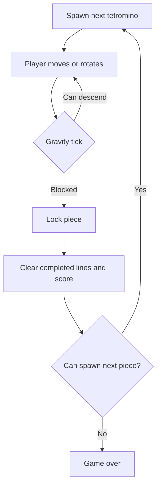

# StackShift

A classic falling-block puzzle, rebuilt as a polished, keyboard- and touch-friendly arcade cabinet. StackShift is powered by Vue 3 and TypeScript, with all game rules running in the browser.

**Play it:** https://oscarmmi.github.io/tetris/

## How to play

Arrange the falling tetrominoes to complete horizontal lines. Cleared lines score points, every ten lines advances the level, and each level makes pieces fall faster. The ghost piece shows where the current piece will land. Your personal best is stored in your browser.

| Action | Keyboard | Touch |
| --- | --- | --- |
| Move | ← / → | Direction buttons |
| Soft drop | ↓ | Down button |
| Hard drop | Space | Drop button |
| Rotate clockwise | Z / ↑ | Rotate button |
| Hold / swap piece | C | Hold button |
| Pause / resume | Esc | Pause button below the board |
| Restart | R | New Game button |

Hold is available once per falling piece. A sequence contains all seven tetrominoes before it repeats.

## Run locally

```sh
npm install
npm run dev
```

Run the game-logic tests and production build:

```sh
npm test
npm run build
```

## Game loop



## Built with

- Vue 3 + TypeScript
- Vite + Vitest
- GitHub Pages
